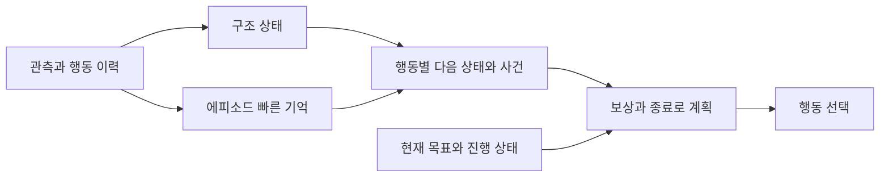

# 재현버퍼 없는 연속 강화학습

2026-11-21 · 중간보고

**제안은 목표 조건부 사건 전이 모델과 고정 크기 빠른 시냅스를 결합하는 것이다.** 문을 열면 무엇이 바뀌는지는 공통 모델에 저장한다. 지금 배치에서 문이 어디 있는지는 빠른 기억에 쓰고, 문을 열었을 때 과제를 끝낼지는 목표에서 정한다. 새 과제가 들어올 때 필요한 변경을 이 세 가지 계산에 나누면 같은 이동·문 규칙을 계속 공유할 수 있다.

## 현재 실험에서 확인한 것

| Unlock 50만 스텝 | Unlock 마지막 5만 스텝 성공률 | 학습 후 DoorKey 고정 평가 |
|---|---:|---:|
| `W_o` 고정 | 146/274 = 53.3% | 476/640 = 74.4% |
| `W_o` 고정, DoorKey에서 계산한 `P` 사용 | 105/245 = 42.9% | 710/793 = 89.5% |

변경 전 DoorKey 고정 평가는 652/754(86.5%)였다. 두 Unlock 실행은 한 시드이며, 정밀도는 DoorKey 자료로 한 번 계산했다. DoorKey 재평가에서 빠른 시냅스는 에피소드 안에서 계속 작동한다. 따라서 이 표에서 읽을 수 있는 것은 한 시드에서 나타난 보존과 새 과제 학습의 교환관계다. 고정 평가만으로 느린 가중치에 옛 지식이 얼마나 남았는지는 판정할 수 없다. [오늘 실험 기록](/workspace/RL-TDP/20261121/실험기록.md)

DoorKey에서 성공 직전 10스텝을 문을 연 뒤의 근사 구간으로 잡았을 때, `W_g`만 바뀌어도 Q가 가장 큰 행동이 44% 바뀌었다. 이 구간에서 Q 변화에 관여한 유닛의 참여비는 8.3이고, `c`는 전체적으로 약 90% 유닛에서 활성이다. 입력의 전체 통계와 행동 결정에 중요한 통계가 다를 가능성이 높다. [겹침 진단](/workspace/RL-TDP/20261121/logs/20261121_diag_overlap_freezewo.json)

## 1. 리플레이가 저장하는 정보와 다시 쓰는 계산

**모델 파라미터 수, 학습 중 보존하는 정보, 연산 예산을 각각 세어야 한다.** 처음에 두 학습기가 같은 경험을 보더라도, 과제가 바뀐 뒤 리플레이 학습기는 옛 관측과 행동, 보상, 종료, 다음 관측을 다시 조건으로 쓸 수 있다. 버퍼는 원래 경험을 보존하고, 반복 학습은 그 경험을 현재 가중치에서 다시 해석하는 계산이다. 모델만 배포하면 추론 파라미터 수는 같다. 학습할 때는 버퍼가 추가 정보를 들고 있고 여러 번의 갱신을 허용한다. CLEAR는 현재 전이와 옛 전이를 섞고, 옛 전이에서 오프폴리시 업데이트와 당시 정책·가치에 대한 모방 손실을 썼다. 그 자체도 저장할 유한한 용량과 과제별 표본 비중의 영향을 받는다. [Rolnick 외, 2019, 2–4절](https://proceedings.neurips.cc/paper/2019/file/fa7cdfad1a5aaf8370ebeda47a1ff1c3-Paper.pdf)

리플레이가 근사하는 것은 과제별 가중합 `L(w) = Σᵢ ρᵢ Lᵢ(w)`이다. `ρᵢ`는 옛 과제에 얼마나 자주 다시 학습 기회를 줄지 정한다. 새 과제 때문에 표현이 움직이면 옛 표본을 새 표현으로 다시 읽고, 옛 행동 점수의 오류가 생긴 방향에 갱신을 준다. 현재의 `P`는 새 과제 쓰기를 옛 입력을 자주 본 방향에서 줄인다. 그 방향이 같은 키·문 규칙을 더 잘 예측하는 데도 필요하면 두 과제에 유리한 쓰기까지 줄어든다.

### 다시 꺼내지 않아도 같은 답을 얻는 경우

고정된 특징 `φ`에 선형 예측 `wᵀφ`를 쓰고 각 샘플의 목표 `y`도 고정하자. 제곱오차에서 현재 오차를 증감시키는 것은 입력의 이차 모멘트 `S`와 입력-목표의 교차항 `b`다.

$$
S=\sum_t \phi_t\phi_t^\top,\qquad b=\sum_t\phi_t y_t,\qquad
\nabla_w \tfrac12\sum_t (w^\top\phi_t-y_t)^2=Sw-b.
$$

두 합을 온라인으로 갱신하면 임의의 현재 `w`에서 원본 데이터 전체로 계산한 기울기를 복원할 수 있다. 릿지 정규화까지 같으면 한꺼번에 적합한 해와 일치한다. 입력이 같은 두 기록에서 보상·목표만 바꾸면 `S`는 같고 `b`는 달라진다. 단, 고정 특징·고정 목표에서 옛 과제의 해 `w_A`를 정확히 보존했다면 `b_A = S_A w_A`이므로 `S_A`와 `w_A`만으로도 그 과제의 기울기를 복원할 수 있다. 이 경우 옛 손실을 보존하는 항은 `S_A(w-w_A)`이다. 현재의 `P`는 이 차이를 계산하지 않는다.

강화학습에서 **고정된 특징과 고정 정책을 평가**할 때는 입력과 다음 특징의 관계가 추가된다. `e_t`는 지금까지 본 특징에 할인율과 흔적 감쇠를 곱해 누적한 자격 흔적이다. `γ_t`는 해당 전이의 할인율이며 실제 종료에서는 0이다. `φ̄_{t+1}`은 고정 정책의 다음 행동들에 대한 평균 특징이다. 선형 LSTD의 정규방정식은 이 통계로 쓸 수 있다.

$$
A=\sum_t e_t(\phi_t-\gamma_t\bar\phi_{t+1})^\top,\qquad
b=\sum_t e_t r_{t+1},\qquad Aw=b .
$$

이 식은 과거 `(φ, a, r, φ′)` 배열 없이 같은 경험의 LSTD 해를 계산할 수 있다는 뜻이다. 선형 Dyna·리플레이 사이의 더 강한 등가는 논문의 모델과 업데이트 조건에서 성립한다. 현재 에이전트는 Q가 바뀌면 다음 행동의 softmax 확률도 바뀐다. 그래서 위 `A`를 그대로 들고 있으면 옛 전이의 새 목표를 재계산할 수 없다. 특징 자체가 움직일 때도 이전 통계와 좌표가 달라진다. 작은 행동 조건부 전이 모델을 유지하고 현재 정책으로 다시 계획하면, 전이 모델이 정확히 담은 범위에서 이런 목표 변경을 처리할 수 있다. [Sutton 외, 선형 Dyna, 2008](https://people.csail.mit.edu/agf/Files/08UAI-ldyna.pdf) · [van Seijen & Sutton, 2015](https://proceedings.mlr.press/v37/vanseijen15.html)

같은 정보라는 말이 **현재 학습 상태에서 옛 표본이 제공하던 관련 정보를 전부 다시 계산할 수 있다**는 뜻이라면, 저장 형식 자체가 성능 차이를 강제하지 않는다. 위 식이 그 예다. 딥 RL에서는 새로운 표현이나 정책으로 옛 자료를 질의할 수 있는 범위가 넓어서 같은 정보를 압축하기 어렵다. 따라서 실험의 질문은 **어떤 구조를 유지하면 과제에 필요한 옛 질의를 고정 크기로 답할 수 있는가**다.

### 동일 파라미터에서 N개의 과제가 들어가는 조건

- 관측과 이력까지 같은데 과제별로 다른 행동이 최적이라면, 목표 단서나 이력에서 얻은 목표 추정이 정책에 들어가야 한다. 첫 구별 신호가 나오기 전에는 같은 이력에 대해 같은 행동 분포만 낼 수 있다. 리플레이를 사용한 모델에도 같은 제약이 있다.
- 태스크 구분을 알려 주더라도, 서로 독립인 정답 비트가 과제마다 하나씩 있다면 모든 경우를 정확히 복원하려면 총 `N`비트가 필요하다. 실제 정밀도의 고정 크기 파라미터와 추론 상태에는 유한한 비트가 들어간다. 리플레이가 추론 때 읽히지 않는 설정에서 이 한계는 공통이다.
- DoorKey와 Unlock처럼 같은 문·열쇠·이동 규칙을 쓰는 과제 가족에서는 구조를 한 번 저장하고 목표의 조합을 입력으로 읽을 수 있다. 목표가 주어지거나 고정 차원의 규칙을 추정할 수 있으면 `N`이 늘어도 과제별 파라미터 복사본은 필요 없다. 달라진 규칙의 종류와 복잡도가 늘 때는 예산 안에서 표현할 범위가 정해진다.

### 고정 크기 통계 수치 검산

| CPU 검산 | 조건 | 결과 |
|---|---|---|
| 선형 LSTD(0) | 8차원 특징, 고정 할인율 0.9, 합성 전이 4,096개, 릿지 0.1 | 온라인으로 더한 `A, b`와 전체 배열에서 계산한 해의 최대 가중치 차이 1.01 × 10⁻¹⁶ |
| 재귀 최소제곱 | 12차원 주소, 4차원 목표, 합성 전이 1,024개, 릿지 0.4 | 전이별 갱신과 전체 배열 회귀의 최대 가중치 차이 1.56 × 10⁻¹⁶ |
| 16개 목표로 계획 | 16칸 원형 그래프, 양방향 이동, 목표에 도착하면 보상 1과 종료, 2,048개 같은 전이 | 32개 상태·행동 쌍 관측, 온라인 전이 카운트와 일괄 카운트가 같음. 16개 목표의 목표 밖 시작점에서 해석적 가치와 최대 차이 1.11 × 10⁻¹⁶ |

첫 두 줄은 계산의 등가를 확인한 것이다. 셋째 줄은 목표가 주어지고 관측한 전이가 상태·행동을 덮을 때 동일한 움직임 모델로 새 목표를 풀 수 있다는 예다. 원형 그래프는 0–15의 칸에서 행동에 따라 인덱스를 1씩 더하거나 빼고, 16으로 나눈 나머지를 다음 칸으로 쓰도록 만들었다. 추정한 전이에서 16회 가치 반복을 했다. 난수 시드는 20261121이다.

## 2. 입력 정밀도만 쓰면 어디서 막히는가

입력 방향을 보호한다는 것은 근사적인 설명이다. 현재 `C`는 평균을 빼지 않은 이차 모멘트 `E[xxᵀ]`다. `P`는 `C + αI`의 역행렬에 `α`를 곱한 값이다. 고유값이 `λⱼ`인 방향에 직접 곱하는 배율은 `α/(α+λⱼ)`다. 과제별 `C`를 합할 때 모든 방향의 고유값이 계속 커지면 `P`는 0으로 간다. 관측하지 않은 영공간에는 원래 쓰기가 남고, 유한한 `α`에서는 옛 과제에 대한 갱신도 남는다. 입출력 관계를 고려하지 않은 투영만으로 옛 행동의 유지나 새 행동의 변화량을 보장할 수 없다. 기존 OWM과 GPM도 활성에서 추정한 부분공간을 활용한다. 이 프로젝트에서 확인할 제약은 두 과제가 실제로 같은 행동 관련 방향을 필요로 하는지다. [Zeng 외, OWM, 2019](https://arxiv.org/abs/1810.01256) · [Saha 외, GPM, 2021](https://openreview.net/pdf?id=3AOj0RCNC2)

현재 Q는 각 유닛의 맥락 `cᵢ`, 출력 가중치 `W_o,i`, 비선형 출력의 곱을 더한다. 한 번의 쓰기가 다른 상태의 Q에 미치는 1차 영향은 **유닛 계수의 내적** $(W_o \odot c_A\odot \mathrm{silu}'_A)^\top(W_o \odot c_B\odot \mathrm{silu}'_B)$과 **입력의 정밀도 가중 내적** $x_A^\top P x_B$의 곱에 비례한다. 여러 스텝의 영향에는 흔적과 TD 오차가 함께 들어간다. 정책에 미치는 영향은 행동 간 Q 차이와 softmax 확률에서 잰다. 특히 문을 연 직후처럼 방문 비율이 낮아도 다음 행동을 결정하는 상태는 따로 점검해야 한다. [Q 읽기](/workspace/ext/dreamerv3/dreamerv3/qagent.py:42) · [쓰기와 자격 흔적](/workspace/ext/dreamerv3/dreamerv3/qagent.py:305)

구현에서 `P`가 적용되는 곳은 실환경의 빠른 시냅스 쓰기다. `W_o`를 학습하거나 `train()`에서 상상 갱신을 켜면 Q를 바꾸는 경로가 더 생긴다. 옛 행동의 유지 여부는 모든 쓰기 경로를 포함해 평가해야 한다. [실환경 갱신](/workspace/ext/dreamerv3/dreamerv3/qagent.py:322) · [상상에서의 직접 갱신](/workspace/ext/dreamerv3/dreamerv3/qagent.py:511)

### 현재 정규화까지 포함한 체크포인트 진단

`E_d`는 `P` 없이 쌓은 빠른 시냅스의 자격 흔적, `E_o`는 출력 가중치의 자격 흔적, `G_d`는 갱신 대상 상태·행동의 Q를 빠른 시냅스로 미분한 값이다. `P`가 고정이면 실제 흔적은 `E_d P`다. TD 오차와 β를 공통으로 두고 쓰기 한 번이 해당 Q에 주는 1차 이득을 구했다. 행렬 내적은 원소별 곱의 합이다.

$$
\kappa(P)=
\frac{\langle G_d,E_d P\rangle_F}
{\lVert E_o\rVert^2+\lVert E_d P\rVert_F^2+\epsilon}.
$$

`W_o`를 고정한 실행에서도 `E_o`가 분모에 남으므로, 이득은 `P`와 선형으로 움직이지 않는다. `0412` 180만 체크포인트를 고정하고 `0515`·`0540`에 이미 기록된 8개 스트림 × 512 프레임을 CPU에서 다시 읽었다. `load_streams`로 최근 구간의 첫 초기화부터 가져왔다. 빠른 시냅스가 0인 동일한 상태·선택 행동과 `λ=0.9, γ=0.99`로, 실제 전이가 없는 에피소드 말단 입력을 제외하고 두 흔적을 재계산했다. `P`는 `0633`이 사용한 `α=1` 행렬이다. 아래는 전이별 값의 중앙값이다. [기준 체크포인트 기록](/workspace/RL-TDP/20261121/실험기록.md) · [스트림 추출 코드](/workspace/ext/dreamerv3/dreamerv3/diag_features.py:50) · [P 행렬](/workspace/RL-TDP/20261121/logs/20261121_P_dk8_alpha1.npy)

| 기록 | 비교 전이 수 | 입력의 자기 읽기 비율 $x^\top Px/x^\top x$ | 빠른 흔적 노름 비율 | Q의 1차 이득 비율 `κ(P)/κ(I)` |
|---|---:|---:|---:|---:|
| DoorKey | 4,062 | 14.9% | 24.0% | 17.4% |
| Unlock | 4,072 | 17.0% | 28.5% | 20.7% |

Unlock에서 이득 비율의 10–90백분위는 16.2–26.8%였다. 같은 DoorKey 관측에서 `dsyn=0`으로 50만 스텝 학습 후의 느린 Q를 읽었다. `W_o` 고정에서 행동 평균을 뺀 Q 변화의 평균 절댓값은 0.02336, 최대 Q 행동 변경 비율은 40.0%였다. `P`를 쓴 체크포인트에서 각각 0.00846과 17.3%였다. 각 체크포인트의 행동별 Q 표준편차 평균으로 온도를 계산한 정책 KL은 각각 0.10854와 0.01452였다. 이는 기존 한 시드의 가중치와 전이에 대한 고정 상태 비교다. 두 실행 전체의 online TD 오차와 반복 학습 경로는 각 실행에서 달랐다.

같은 기록의 선택 행동으로 DoorKey의 평균 이차 모멘트 `C_A`와 Unlock의 `C_B`를 따로 계산했다. `α=1`에서 Unlock 입력의 평균 자기 읽기 비율은 `C_A`에서 18.8%, `C_A+C_B`에서 9.3%, `(C_A+C_B)/2`에서 13.4%였다. 평균은 합의 크기 증가를 없애도, 새 입력이 몰린 방향을 보호하는 효과를 남겼다. 이 비교는 보존 강도와 학습 곡선을 예측하는 대리 지표로 쓰지 않고, 합과 평균이 실제 쓰기 벡터에 주는 영향을 확인하는 데 썼다.

## 3. 문헌에서 가져올 계산

### TEM과 TEM-t

**TEM의 재사용 단위는 행동에 따른 구조의 변화다.** 같은 이동 관계를 가진 새 그래프에 들어가면 느린 전이 가중치는 유지한다. 행동을 받아 갱신하는 구조 코드 `g`가 현재 위치나 관계상의 자리를 나타낸다. 빠른 해마 기억은 그 자리와 이번 환경의 관측 `x`를 결합한 코드 `p`를 저장한다. 예측한 구조 코드로 빠른 기억을 읽어 다음 관측을 예측하고, 익숙한 관측은 누적된 경로적분 오차를 고치는 단서로도 쓴다. 원 논문은 환경이 바뀌면 빠른 기억을 초기화하고, 느린 가중치는 시간 역전파로 학습한다. 빠른 기억도 예측한 결합을 빼고 남은 성분을 쓰며 감쇠율을 둔다. [Whittington 외, TEM, 2020, 그림 2 및 STAR Methods](https://discovery.ucl.ac.uk/id/eprint/10115119/7/1-s2.0-S009286742031388X-main.pdf)

**TEM-t는 그 결합을 구조 코드로 주소를 찾는 어텐션으로 구현한다.** 다음 행동으로 도달할 구조 코드가 질의다. 과거 위치의 구조 코드가 키이며, 그곳에서 본 감각 내용이 값이다. 시작 위치나 감각 배치가 바뀌어도 같은 관계를 따라 전에 본 위치로 돌아오는 계산을 배운다. 원래 softmax 어텐션은 지난 키·값을 문맥으로 유지한다. 논문이 TEM과의 관계를 보이는 식에서는 단순화한 선형 읽기와 softmax식을 나란히 놓는다. 원래 TEM-t를 채택하면 에피소드 길이만큼 문맥이 늘어나는 문제가 있으므로, 고정 크기 실험에서는 선형 키·값 읽기와 예측오차 쓰기를 검토한다. [Whittington, Warren & Behrens, TEM-t, 2022, 3–5절](https://openreview.net/pdf/684a0f0eef15279b5b52184a954e3ca24a2217ac.pdf)

TEM의 4바퀴 과제에서 보상은 주기적으로 나오는 감각 사건이었다. TEM-t 비교도 주어진 행동에서 다음에 무엇을 볼지 맞추는 실험이다. RL로 옮기려면 실제로 선택할 여러 행동의 결과를 예측하고, **같은 결과를 현재 목표의 보상과 종료 규칙으로 점수화한 뒤 행동을 골라야 한다.** 예를 들어 문 상태를 닫힘에서 열림으로 바꾸는 전이와 이번 과제에서 그 순간을 끝으로 삼는 결정은 서로 다른 학습 목표다. 기억에서 직접 가져올 것은 방·열쇠·문의 현재 배치와 관측 단서다. 환경별 보상을 그 기억에 직접 쓰는 순간 같은 문에서 서로 다른 가치가 충돌할 수 있다. [TEM의 4바퀴 설정](https://discovery.ucl.ac.uk/id/eprint/10115119/7/1-s2.0-S009286742031388X-main.pdf) · [TEM-t의 행동 조건부 관측 예측](https://openreview.net/pdf/684a0f0eef15279b5b52184a954e3ca24a2217ac.pdf) · [보상 기계의 사건·과제 상태 분해](https://proceedings.mlr.press/v80/icarte18a.html)

### 시냅스 가소성, 국소학습, RL 전이

| 연구 | 이 프로젝트에서 적용할 부분과 성립 조건 |
|---|---|
| **Delta rule 기반 빠른 가중치** | 빠른 기억을 행렬로 두고 현재 키에서 읽은 값과 참값 사이의 오차만 쓴다. 반복 관측이 이미 맞으면 갱신은 0에 가까워진다. 서로 다른 내용이 같은 키를 받으면 계속 간섭하므로 구조와 배치 단서로 구분하고 실제 읽기에서 겹침을 재야 한다. 원 논문은 선형 어텐션의 외적 덧셈을 이런 규칙으로 바꿨다. [Schlag, Irie & Schmidhuber, 2021](https://proceedings.mlr.press/v139/schlag21a.html) |
| **여러 시간척도의 시냅스** | Benna–Fusi는 한 시냅스의 빠른 변수와 더 오래 남는 내부 변수를 연결한다. Kaplanis 외는 반복 교대 과제의 재학습과 단일 과제의 버퍼 없는 온라인 학습을 각각 시험했다. 공유 전이의 느린 추정량과 현재 배치의 빠른 잔차를 나누는 근거가 된다. 동시에 모든 환경에서 다른 목표를 기억하려면 어느 변수를 읽을지 알려 주는 맥락이 별도로 필요하다. [Benna & Fusi, 2016](https://arxiv.org/abs/1507.07580) · [Kaplanis, Shanahan & Clopath, 2018, 3.2–3.3절](https://proceedings.mlr.press/v80/kaplanis18a.html) |
| **맥락 게이트와 선택적 안정화** | 활성 유닛을 맥락으로 골라 쓰기와 읽기를 함께 제한한다. 현 `c`는 유닛을 폭넓게 활성화하므로, 목표에 민감한 잔차에만 고정 폭 희소 게이트를 걸고 이동·상호작용 예측은 공유하는 대조군이 적합하다. 게이트 슬롯마다 새 과제를 배정하면 슬롯 수가 곧 예산이 된다. [Masse, Grant & Freedman, 2018](https://doi.org/10.1073/pnas.1803839115) · [Liu 외, RL의 희소 표현, 2019](https://cdn.aaai.org/ojs/4349/4349-13-7396-1-10-20190706.pdf) |
| **자격 흔적과 3요인 학습** | 시냅스 입력과 해당 출력의 활동 또는 오차로 흔적을 만들고, 뒤늦은 TD 오차로 쓰기를 조절할 수 있다. 느린 비선형 표현을 읽는 마지막 선형 값 경로나 보상·사건을 직접 내는 빠른 출력층에서는 학습 신호가 그 층에서 정의된다. 현 `dsyn`은 `W_o`를 거쳐 Q 오차를 아래 유닛에 배분한다. 목표별 보상 헤드와 사건 예측 헤드를 따로 두면 빠른 쓰기에 그 가중치를 역으로 곱할 이유가 사라진다. [Frémaux, Sprekeler & Gerstner, 2013](https://journals.plos.org/ploscompbiol/article?id=10.1371/journal.pcbi.1003024) · [Bellec 외, e-prop, 2020](https://doi.org/10.1038/s41467-020-17236-y) |
| **후속 특징과 일반화 정책 개선** | 보상에 공통 사건 특징 `φ`의 가중합을 쓰면, 한 정책에서 기대되는 할인 누적 사건 `Ψ^π`를 여러 보상에서 읽을 수 있다. 여러 기초 정책이 있으면 새 보상에서 점수를 다시 매겨 행동을 고른다. 이 등가는 전이와 할인·종료가 공통이라는 조건을 쓴다. Unlock과 DoorKey처럼 종료 사건이 바뀌면 목표 상태와 종료를 계획에 넣어야 한다. 제한된 기초 정책으로 못 찾는 행동열도 모델에서 탐색할 수 있다. [Barreto 외, 2017](https://proceedings.neurips.cc/paper/2017/hash/350db081a661525235354dd3e19b8c05-Abstract.html) · [Borsa 외, 2019](https://openreview.net/pdf/70175fb6b53961f2a1af03e5550716938c3a5158.pdf) |
| **가소성 회복과 온라인 안정화** | Continual Backprop은 덜 쓰이는 유닛을 일부 재초기화해 새 학습에 쓸 수 있게 했다. Stream-x는 버퍼 없는 스트리밍 제어에서 업데이트 안정화가 가능함을 보였다. 양쪽 모두 이 프로젝트에서는 새 과제의 학습 속도 대조군이다. 예전 행동을 지키는 항은 별도로 확인해야 한다. [Dohare 외, 2024](https://doi.org/10.1038/s41586-024-07711-7) · [Elsayed 외, Stream-x](https://arxiv.org/abs/2410.14606) |

`C`의 지수이동평균이나 `α` 조정은 보호 강도를 바꾸는 대조군이다. 생성 리플레이는 원본 전이 저장을 학습된 생성기로 바꾸고, 생성한 과거 전이로 재학습한다. 제안 모델에 필요한 생성 계산은 현재 상태에서 출발하는 미래 결과의 계획이다. [생성 리플레이의 분류 실험](https://www.nature.com/articles/s41467-020-17866-2) · [Continual-Dreamer의 선택적 실경험 리플레이](https://proceedings.mlr.press/v232/kessler23a.html)

## 4. 제안 아키텍처

### 행동으로 바뀌는 상태와 목표를 표현한다

| 표현 | 무엇을 담는가 | 학습과 초기화 |
|---|---|---|
| 구조 상태 `g` | 위치·방향의 추정, 보이는 물체와 관계, 손에 든 물체, 문 상태. 같은 사건을 일으키는 조건을 여러 배치에서 공유한다. | RSSM의 연속 관측·행동 이력에서 읽는다. 첫 시험에서는 기존 월드모델을 고정하고, 사건과 다음 상태를 예측하는 작은 경로를 학습한다. |
| 에피소드 기억 `M_f` | 현재 배치에서만 맞는 단서와 전이 잔차. 예를 들어 예측과 다른 위치에서 벽에 막힌 결과나 여기서 알아낸 문의 위치다. | 새 관측에서 예측오차를 국소적으로 쓴다. 환경별로 에피소드 시작에 초기화한다. |
| 목표 `ω`, 진행 상태 `b` | 어떤 종류의 사건이 보상과 실제 종료를 만들며, 이미 어떤 단계가 끝났는가. | 지시나 과제 단서로 조건을 주거나 실제 사건·보상·종료에서 추정한다. 지시 표현과 보상 예측기의 폭을 고정한다. |

느린 전이 경로는 행동에 따른 **다음 구조 상태와 사건의 공동 분포**를 예측한다. 예를 들어 앞에 닫힌 문이 있고 맞는 열쇠가 손에 있으면, 열기 행동에서 문이 열리는 사건과 문이 열린 상태를 함께 예측한다. 사건별 보상과 종료를 판정하는 경로는 그 예측을 받아 현재 목표에서의 보상·진행·종료를 정한다. 실제 DoorKey-8x8과 Unlock은 시작 배치, 방 크기, 목표 오브젝트의 유무도 다르다. 공유할 대상은 그 안의 상호작용 규칙이다. 두 장면을 같은 `g`로 압축하려면, 같은 행동이 다음 구조 상태와 사건을 만드는 분포도 비슷해야 한다. 잠긴 문과 열린 문이 같은 상태로 압축되면 이 조건이 깨진다. [DoorKey 등록 설정](/venv/main/lib/python3.12/site-packages/navix/environments/door_key.py:180) · [Unlock 환경](/venv/main/lib/python3.12/site-packages/navix/environments/unlock.py:145)

첫 시험은 정책이 이미 계산하는 RSSM의 순환 상태 `h_t`와 관측을 반영한 잠재 상태 `z_t`를 합쳐 `g_t`로 사영한다. `g_t`와 행동을 작은 망에 넣어 주소를 만든다. 전이 머리는 다음 `g`를 같은 폭으로 내므로 계획의 두 번째 스텝부터도 동일한 머리를 호출할 수 있다. 기존 `_candidates()`가 내는 RSSM의 행동별 예측은 첫 스텝의 기준선이나 사건 추정의 단서로 쓴다. [RSSM의 관측 갱신](/workspace/ext/dreamerv3/dreamerv3/rssm.py:75) · [후보 행동 계산](/workspace/ext/dreamerv3/dreamerv3/qagent.py:206)

사건을 얻는 방식은 두 단계로 확인한다. 관계 자체를 시험할 때는 실제 문 열림·열쇠 획득·목표 도달 라벨을 모든 모델에 동일하게 준다. 1인칭 RGB 시험에서는 현재 행동을 반영한 RSSM 예측과 실제 다음 관측을 반영한 잠재의 차이, 앞뒤 관측의 변화를 입력으로 써 사건을 추정한다. 구체적으로는 그 변화에서 고정 수의 사건 코드 중 다음 잠재 상태 예측에 가장 잘 맞는 코드를 고르고, 다음 스텝부터 `(g, a)`만으로 그 코드를 예측하도록 학습한다. 예를 들어 열기 행동에서 닫힌 문 이미지가 열린 문으로 바뀌는 변화가 다른 방에서도 같은 코드로 예측되는지 검증한다. 보이지 않는 물체는 이력에서 추정하고, 상호작용이 다른데 같은 코드로 합쳐지는 비율을 따로 잰다. 느린 회귀의 정확한 비교는 이 사건 코드와 주소를 공통 학습 구간에서 학습한 뒤 고정한 조건에서 한다. [NAVIX의 RGB 관측](/workspace/ext/dreamerv3/embodied/envs/navix.py:37) · [행동 조건부 잠재 예측 학습](https://openreview.net/pdf?id=uCQfPZwRaUu)

### 읽은 값의 오차를 두 곳에 직접 쓴다

**빠른 배치 기억.** `k_t`는 현재 구조 상태와 행동에서 만든 주소이고, `y_{t+1}`은 실제 다음 관측에서 얻은 상태·사건 내용이다. 먼저 느린 예측과 해당 주소에서 읽은 빠른 잔차를 더해 `ŷ = ŷ_s + M_f k_t`를 만든다. 연속값이나 원핫 사건을 제곱오차로 적합하는 첫 구현에서 빠른 쓰기는 다음과 같다.

$$
M_f \leftarrow M_f+
\eta_f\frac{(y_{t+1}-\hat y)k_t^\top}{\epsilon+\|k_t\|^2}.
$$

각 시냅스는 자기 입력과 자기 출력의 예측오차를 곱한다. 같은 주소에서 같은 내용이 이미 맞으면 쓰기량은 0에 가까워진다. 다른 주소의 읽기가 얼마나 바뀌는지는 두 주소의 내적으로 계산할 수 있다. 이 변경을 에피소드별 메모리에 두면 다른 배치의 좌표에 쓰기가 전달되지 않는다. 반복되는 상태를 정확히 맞추는지부터 확인하고, 주소가 모호한 곳에 한해 희소한 맥락 결합을 쓴다. 사건이 여럿 가능한 경우 계획은 각 사건에 대응하는 다음 상태를 함께 읽어야 한다. 사건 확률 평균과 다음 상태 가치 평균을 따로 곱하면, 예를 들어 문이 열리는 경우에만 들어갈 수 있는 상태의 값을 잘못 더하게 된다.

**빠른 목표 적응.** `f`는 발생한 사건과 현재 진행 상태를 묶은 특징이고, `u_f`는 그 사건에 대한 빠른 보상 가중치다. 느린 목표 예측에 `u_fᵀf`를 더한 보상 `r̂`을 실제 `r`과 비교하고, `u_f`를 `(r−r̂)f` 방향으로 갱신한다. 실제 종료를 예측하는 로짓도 `(is_terminal−p_terminal)f`로 갱신한다. 첫 실험의 진행 상태는 목표 사건 전과 완료 두 단계이고, 사건 순서가 달라지는 실험에서 중간 단계를 둔다. 지시나 반복해서 확인할 수 있는 단서가 있을 때, 느린 목표 예측은 그 단서와 사건의 결합을 학습한다. 첫 보상 전에 두 목표의 관측 이력이 같다면, 이전 과제로부터 온 사전확률을 두고 실제 사건·보상·종료의 가능도를 곱해 목표 확률을 갱신한다. `is_last`로는 에피소드 기억을 비우고 `is_terminal`로는 부트스트랩을 끊는다. [빠른 선호의 기존 코드](/workspace/RL-TDP/rltdp/agent/sf.py:20) · [NAVIX 종료 플래그](/workspace/ext/dreamerv3/embodied/envs/navix.py:64)

### 공통 예측을 느린 가중치에 남긴다

공유 상태·행동 주소 `k_s`와 관측 목표 `y`를 쌍으로 사용한다. 주소는 여러 배치에서 의미가 유지되는 특징이다. 고정 주소에서 느린 선형 예측 행렬 `M_s`를 회귀할 때는 입력의 이차항 `S`와 입력-내용의 교차항 `B`가 옛 오차를 복원한다. `μ`는 릿지 계수다.

$$
S=\mu I+\sum_t k_{s,t}k_{s,t}^{\top},\qquad
B=\sum_t y_t k_{s,t}^{\top},\qquad M_s=BS^{-1}.
$$

두 합은 한 번 본 전이마다 한 번 갱신한다. 재귀 최소제곱은 `M_s`와 `S⁻¹`을 직접 유지해 같은 답을 얻는다. 주소 `k_s`에서 쓸 비율 `K`를 구한 뒤, 그 주소의 예측오차를 쓴다.

$$
K=\frac{S^{-1}k_s}{1+k_s^\top S^{-1}k_s},\qquad
M_s \leftarrow M_s+(y-M_sk_s)K^\top,\qquad
S^{-1}\leftarrow S^{-1}-K k_s^\top S^{-1}.
$$

행렬 `S⁻¹`은 주소 성분 사이의 상관을 계산한다. 이 연산은 모듈 안에서 끝난다. 시냅스별 연산량을 더 줄이려면 대각 통계를 쓸 수 있고, 이 경우 서로 다른 주소 성분 사이의 상관을 근사한다. 이미 정확히 추정한 공통 관계는 오차가 작고, 새로운 보상 규칙은 별도 목표 경로에서 계속 배울 수 있다.

빠른 시냅스에서 느린 비선형 망으로의 기존 증류를 시험할 때는, 전이가 도착한 시점에 **그 주소에서 빠른 시냅스가 내는 예측**을 정지 기울기 목표로 느린 경로에 전달한다. 에피소드 끝에는 필요하면 그 에피소드의 두 합만 합친다. 에피소드 고유 위치의 주소를 전역 주소처럼 합치거나 `M_f` 전체를 `W_g`에 그대로 더하면 배치 잔차가 다음 에피소드에 섞인다. 먼저 관측값을 직접 쓰는 회귀를 기준으로 두면, 빠른 예측을 증류할 때 생기는 편향과 느린 비선형 특징의 변화 효과를 잴 수 있다. 선형 회귀의 정확한 등가는 주소가 고정된 동안 성립한다. [기존 설계의 빠른 선호와 증류](/workspace/RL-TDP/docs/design_draft2.md:23) · [현 에피소드 종료 전이](/workspace/ext/dreamerv3/dreamerv3/qagent.py:322)

정밀도는 각 예측의 신뢰도를 추정하는 데 쓴다. 예를 들어 같은 문이라도 아직 열기 행동을 본 적 없다면 그 사건의 예측 불확실성을 높게 보고 확인할 수 있다. 가우시안 선형 회귀에서는 새 주소에 대한 가중치 불확실성의 기여가 `k_sᵀS⁻¹k_s`에 비례한다. 실제 사건 오차와 이 값이 얼마나 맞는지 보고, 배치·보상 예측에서 별도로 사용한다.

### 지금 목표에서 다시 행동을 고른다

`E`는 전이 모델이 예측한 사건이고 `g′`는 가능한 다음 구조 상태다. `b′`는 사건을 본 뒤의 목표 진행 상태다. `V_ω`는 그 지점에서 내다본 남은 보상이다. 현재 목표의 사건 보상 `r_ω`와 종료 표시 `d_ω`로 가능한 결과를 합산한다.

$$
Q_\omega(g,b,a)=\mathbb E\!\left[
 r_\omega(b,E) + \gamma\big(1-d_\omega(b,E)\big)V_\omega(g',b')
\;\middle|\;g,b,a,\omega\right].
$$

문을 연 전이에서 Unlock은 보상 1에 종료이므로 그 자리의 목표 점수가 1이다. DoorKey에서는 그 전이의 즉시 보상이 0이고, 그 뒤 목표 칸까지 갈 때의 가치가 이 행동에 붙는다. 그래서 Unlock 데이터에는 문을 연 뒤의 새 행동이 없어도, 그 뒤 전이를 이미 배웠다면 DoorKey 목표에서 계속 계획할 수 있다. 목표에 따라 다른 `r, d`로 같은 전이를 재평가할 때 리플레이의 재계산 기능을 모델이 담당한다.

현재 7개 행동 각각의 가능한 결과를 내고, 현 관측에서 제한된 길이·분기 수로 다단계 계획을 한다. 짧은 계획이 열쇠–문–목표 순서를 덮지 못하면, 목표 조건부 느린 가치나 문 열기 같은 기술 단위로 남은 구간을 평가한다. 고정 정책의 후속 특징은 이 계산을 줄이는 후보이며, 종료까지 같은 과제군에서 먼저 비교한다. 가치 머리의 예측과 계획이 얼마나 일치하는지 따로 재면 이 보조 예측기가 옛 과제의 새 간섭 경로가 되는 경우를 찾을 수 있다. 실제 관측에서 보지 못한 행동의 정확한 결과는 모델 일반화에 달려 있으므로, 문과 목표 같은 결정 사건의 다단계 예측 정확도와 방문 범위를 함께 기록한다. 계획에서 쓰는 임시 후보 수는 고정하고 매 결정 후 버린다. [전이·보상이 비슷할 때의 상태 추상화 조건](https://proceedings.mlr.press/v48/abel16.html) · [프로젝트의 후속 특징 TD 목표](/workspace/RL-TDP/rltdp/agent/sf.py:64)

Craftax나 Minecraft처럼 수십 행동이 필요한 구간은 열쇠 획득이나 제작 같은 기술의 **결과와 소요 스텝**을 같은 전이 모델에서 예측하는 확장으로 다룬다. 기술을 시작한 상태와 실행 중 보상 합을 유지하고, 끝날 때 관측 결과를 한 번 쓴다. 기술이 `L`스텝 걸렸다면 이후 가치는 `γ^L`로 할인한다. 과제가 바뀌면 각 기술의 새 목표 점수를 계산하고 조합을 바꾼다. 실제 적용은 행동을 실행할 때마다 관련 물체·인벤토리·제작 결과를 관측에서 구별하고, 기술이 실패할 확률과 종료를 예측할 수 있어야 한다. [Sutton, Precup & Singh, 시간 추상화, 1999](https://people.eecs.berkeley.edu/~russell/classes/cs294/f05/papers/sutton%2Bal-1999.pdf)

### 용량과 코드 변경 범위

현 `size1m`의 느린 Q 파라미터는 `W_g` 512 × 512와 `W_o` 512, 총 **262,656개**다. 공통 월드모델에는 570,483개가 있다. 별도로 `P`가 FP32 1 MiB이고, 16개 환경의 `dsyn`과 `e_d` 두 배열이 합계 32 MiB다. 타깃 가중치의 사본과 체크포인트도 상태 예산에 포함한다. [QHead와 정책 상태 크기](/workspace/ext/dreamerv3/dreamerv3/qagent.py:129)

예산을 잡기 위한 한 예는 아래와 같다. 사건 종류 16개는 첫 시험의 시작 크기다. 제곱오차로 맞춘 사건 출력은 가능한 사건들의 합이 1인 확률 벡터로 사영한다. 그 확률과 사건별 다음 상태를 함께 써서 계획한다.

| 교체하는 부분 | 시작 폭 | 학습 파라미터 |
|---|---|---:|
| 상태 사영과 행동 주소 | 640→128 상태 사영. 상태와 행동 7개를 합쳐 135→128 주소 | 99,456 |
| 사건과 조건부 다음 상태 예측 | 128→16 사건. 주소 128과 사건 16을 받아 144→128 다음 상태 | 20,624 |
| 목표와 종료 | 128→16 목표 사전. 사건·진행 특징 16과 목표 16의 결합에서 보상과 종료를 각각 예측 | 2,578 |
| 계획의 잔여 구간 가치 | 상태 128, 목표 16 및 진행 16을 합쳐 160→256→7 | 43,015 |
| 합계 | 기존 Q 경로의 총량 이내 | **165,673** |

선형 사건·다음 상태 머리의 재귀 최소제곱을 쓸 경우, 절편을 포함한 129×129와 145×145 역행렬이 FP32 약 147 KiB다. 같은 폭의 환경별 빠른 잔차 가중치는 16개 환경에서 약 1.25 MiB다. 여기에 목표 추정 상태와 계획 임시 메모리가 붙고, RGB에서 사건을 발견하는 조건은 16 × 128 사건 코드북 파라미터를 추가할 수 있다. 비교 실험에서 이 아키텍처의 리플레이 사용 여부를 바꿀 때는 추론 파라미터 수를 정확히 같게 둘 수 있다. 현 Q 경로와 비교할 때도 폭을 조정해 실제 파라미터 수를 맞춘다. 모든 장기 상태의 크기는 실험 시작에 고정한다.

1. `policy()`는 기존 `dyn.observe()` 출력에서 구조 상태를 계산한다. 정책 상태에는 마지막 주소, 에피소드별 빠른 잔차와 목표 추정을 둔다. 다음 실제 관측이 오면 관측 오차를 쓴 뒤 현재 목표에서 행동을 평가한다. `_candidates()`는 기존 Q 경로의 대조군과 RSSM 예측을 사용한 사건 추정에 재사용한다.
2. `W_g ← W_g + dsyn` 전이를 공유 예측과 목표 예측 각각의 출력 증류로 바꾼다. `qwrapper.py`에는 공용 가중치와 통계의 복사본만 반영하고, 에피소드별 행렬은 정책 상태에 둔다. 여러 환경에서 전이가 같은 호출에 들어오면, 각 전이의 통계 증분을 한 번씩 합친다. 타깃 로짓과 평가에서는 읽기·쓰기 상태를 명시적으로 고정한다.
3. `train_ratio=0`은 현재 코드에서 학습 샘플 사용을 멈춘다. 드라이버는 여전히 `replay`를 만들고 `replay.add`를 호출해 전이를 저장하며 체크포인트에도 연결한다. 실제 무버퍼 실행은 이 드라이버 연결과 리플레이 스트림을 제거하고, 새 전이를 `policy()`의 쓰기와 느린 경로에 한 번만 전달한다. 기존 월드모델의 보상·종료 헤드는 DoorKey 단계의 값을 예측하므로 새 목표에서 계획할 때 위의 조건부 헤드를 쓴다. [qwrapper.py의 공유 가중치 갱신](/workspace/ext/dreamerv3/dreamerv3/qwrapper.py:44) · [드라이버의 replay 연결](/workspace/ext/dreamerv3/embodied/run/train.py:66) · [현재 상상의 보상·종료 계산](/workspace/ext/dreamerv3/dreamerv3/qagent.py:482)

빠른 기억으로 장면을 바꿔도 공유 주소가 유지되는 동안 느린 통계의 의미는 같다. 새로운 물리 규칙이 늘어나는 경우에는 예측오차와 환경 단서로 구분되는 고정 수의 전이 잔차를 둘 수 있다. 한 자리에서 서로 다른 규칙을 동시에 맞춰야 하면 용량을 사용한다. 오래 남은 잔차를 보호하는 가소성 규칙은 이 경우에만 시험하고, 공통 전이의 자리를 과제별로 하나씩 배정하는 방식은 과제 수 증가의 대조군으로 쓴다.

## 5. 검증 순서

| 단계 | 통제할 것과 읽을 지표 |
|---|---|
| **같은 방에서 종료 목표만 교체** | 같은 DoorKey 배치를 써서 첫 번째 조건은 문 열기, 두 번째 조건은 목표 도달에 보상과 실제 종료를 준다. 조건 단서가 같은 정보를 주는 모든 에이전트를 비교한다. 종료 후 관측을 새로 수집하지 않고, 각 과제가 실제 준 전이만 사용한다. 문 열기 전이의 사건 예측, 목표별 보상·종료 예측, 문을 연 뒤의 행동과 성공률을 잰다. |
| **실제 DoorKey → Unlock → DoorKey** | 방 크기와 객체 구성이 바뀌는 조건이다. 같은 DoorKey 월드모델로 시작하는 비교에서는 새 Q 경로도 DoorKey의 첫 학습 구간에서 한 번 관측하며 적합한다. 돌아왔을 때 느린 상태 고정·빠른 쓰기 끔과 에피소드 안 빠른 쓰기 켬을 모두 재서, 보존한 성능과 다시 적응한 성능을 구한다. |
| **과제 수와 구조 차이 증가** | 같은 물리 규칙에서 목표·순서·배치 조합을 2, 4, 8, 16개로 늘리고, 본 적 없는 조합도 평가한다. 전이 규칙이 바뀌거나 단서가 부족한 조건에서는 별도로 같은 자료를 주고 맥락 충돌을 잰다. 과제마다 따로 모델을 학습한 성능은 가능한 성능의 참조값이다. [조합형 RL 벤치마크 CompoSuite](https://proceedings.mlr.press/v199/mendez22a/mendez22a.pdf) |

비교군은 **현 Q**, **현 Q + 고정 `P`**, **동일 모델과 동일 목표 입력을 쓰는 리플레이 학습**, **제안 구조**다. 제안 구조 안에서는 빠른 배치 기억, 목표 조건, 느린 교차 통계를 하나씩 빼 각 항의 기여를 잰다. 움직임·사건 모델만 공통으로 두고 목표 조건부 Q를 직접 TD로 학습하는 판도 두면, 표현 분리 효과와 계획의 효과를 구분할 수 있다. 목표 단서를 뺄 때는 RGB와 실제 보상·종료만으로 추정하는 버전과 비교한다. 단서가 있기 전의 성능과 첫 사건 뒤의 성능을 따로 기록한다.

두 질문에는 비교가 각각 필요하다. **같은 관측 스트림**에서 예측 학습을 비교하면 옛 데이터 접근과 통계 압축의 차이를 볼 수 있다. **같은 환경 스텝과 초기 시드**에서 제어를 비교하면 정책이 어떤 데이터를 새로 모으는지까지 반영한다. 두 비교 모두 독립 가중치 수, 학습 중 CPU·GPU·디스크의 보존 바이트, 새 환경 스텝, 실제 갱신 횟수, 계획에서 쓰는 모델 호출 수와 시간을 기록한다. 리플레이가 큰 기준과 총 바이트를 맞춘 작은 리플레이를 둘 다 둔다. 시간이 늘면 어느 비교군이 그 시간으로 어떤 계산을 하는지도 확인할 수 있다.

각 학습 단계 직후 전체 과제로 만든 평가 행렬을 저장한다. 이전 과제 성능 감소량과 새 과제 초반 학습곡선 면적을 같이 보며, 비교에는 같은 순서의 여러 시드를 쓴다. 공유 상태의 사건별 예측 오차, 실제 방문 빈도, 목표 오분류율, 문 열기 전후의 행동 점수와 정책 KL을 같이 남긴다. 희귀 사건이 전체 평균에 묻히는지 확인한다. 성공률과 시간에 대한 채택 기준은 이 보고의 기존 한 시드 숫자로 정하지 않았다. [Continual World의 보존·전이 평가](https://proceedings.neurips.cc/paper/2021/file/ef8446f35513a8d6aa2308357a268a7e-Paper.pdf) · [CORA의 지표](https://proceedings.mlr.press/v199/powers22b.html)

기존 체크포인트를 쓰는 시험은 **전환 이후의 무버퍼 학습**을 검증한다. 처음부터 무버퍼 조건에서는 월드모델도 현재 관측과 직전 상태·행동에서 한 번씩 학습한다. 필요하면 느린 모듈이 막 도착한 짧은 연속 구간을 한 번 학습하고 버리는 조건을 따로 비교한다. 빠른 기억의 국소 쓰기는 두 조건에서 같다. 이 전체 파이프라인의 학습 안정성과 실제 NAVIX의 다중 시드·다중 과제 성능은 후속 검증 항목이다.
